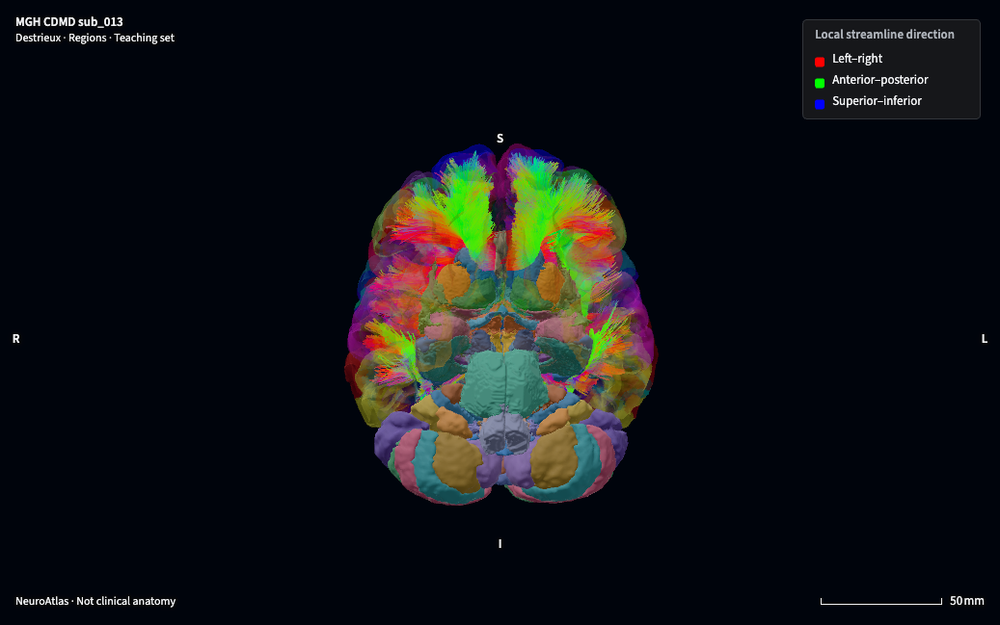

<p align="center">
  <a href="https://joshuaduq.github.io/neuroatlas/">
    <picture>
      <source media="(prefers-color-scheme: dark)" srcset=".github/assets/planum-dark.svg">
      
    </picture>
  </a>
</p>

<p align="center"><strong>Explore one person's brain in 3D.</strong><br>
A browser atlas for neuroscience education and research.</p>

<p align="center">
  <a href="https://joshuaduq.github.io/neuroatlas/"><strong>Open the viewer</strong></a> ·
  <a href="https://joshuaduq.github.io/neuroatlas/docs/">Documentation</a> ·
  <a href="https://joshuaduq.github.io/neuroatlas/docs/validation.html">Validation and limits</a>
</p>

[](https://joshuaduq.github.io/neuroatlas/)

Planum displays a FreeSurfer reconstruction of MGH CDMD subject `sub_013`, alongside tracts derived from the same subject's diffusion scan. Select regions, dissect the model, make sections, and compare them with linked MRI. Explore cortical atlases, internal structures, functional maps, guided circuits and tract bundles in English or French.

The anatomy represents one individual. Projected atlases, modelled segmentations, functional maps and tractography have distinct limitations; they are not measurements of this person's function or a clinical reference. **Planum is for research and education, not clinical decisions.** See [validation and limits](https://joshuaduq.github.io/neuroatlas/docs/validation.html).

## Run locally

The viewer needs Node.js and a WebGL 2 browser. The repository includes the published assets; no Python build is needed to explore them.

```bash
cd web
npm ci
npm run dev
```

Open the address printed by Vite (normally `http://127.0.0.1:5173/neuroatlas/`). The repository is large because it includes model and diffusion data.

## Build and verify

The Python pipeline requires [uv](https://docs.astral.sh/uv/) and Python 3.12 or 3.13. The committed sources are sufficient to rebuild the published anatomy:

```bash
uv sync --locked
uv run python -m brain_model.build --anatomy cdmd
uv run python -m brain_model.validate --anatomy cdmd
```

To run tests and build the documentation:

```bash
uv run pytest
npm test --prefix web
uv sync --locked --group docs
uv run sphinx-build -W -b html docs docs/_build/html
```

See [installation](https://joshuaduq.github.io/neuroatlas/docs/install.html) and [building an anatomy](https://joshuaduq.github.io/neuroatlas/docs/guides/building.html) for prerequisites, source preparation and regeneration. The [embedding guide](https://joshuaduq.github.io/neuroatlas/docs/guides/embedding.html) explains how to use the Three.js components in another application.

## Data and licences

The code is MIT licensed; data have separate terms. In particular, HCP-MMP data have HCP use terms, CAB-NP is non-commercial, Julich-Brain is CC BY-NC-SA, Neurosynth-derived databases are ODbL, and the PAM50 cord atlas is MIT. TractSeg-derived bundles require attribution. See [references and licensing](https://joshuaduq.github.io/neuroatlas/docs/reference/references.html) for sources, citations and complete terms.
