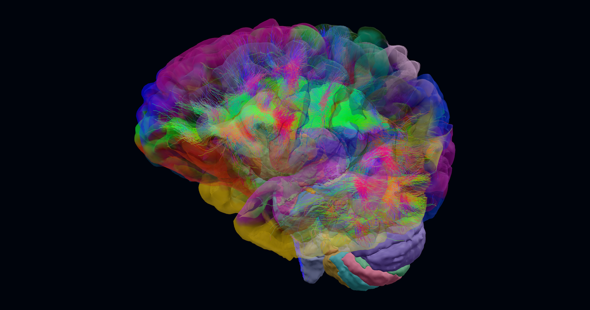

<p align="center">
  <a href="https://joshuaduq.github.io/neuroatlas/">
    <picture>
      <source media="(prefers-color-scheme: dark)" srcset=".github/assets/planum-dark.svg">
      
    </picture>
  </a>
</p>

<p align="center">
  <strong>One person's brain, at full resolution.</strong><br>
  A source-faithful 3D atlas for neuroscience teaching and anatomical research,<br>
  built on individual FreeSurfer reconstructions rather than a template.
</p>

<p align="center">
  <a href="https://joshuaduq.github.io/neuroatlas/"><strong>Open the viewer</strong></a>
  &nbsp;·&nbsp;
  <a href="https://joshuaduq.github.io/neuroatlas/docs/">Documentation</a>
  &nbsp;·&nbsp;
  <a href="https://joshuaduq.github.io/neuroatlas/docs/guides/embedding.html">Embed the API</a>
  &nbsp;·&nbsp;
  <a href="https://joshuaduq.github.io/neuroatlas/docs/validation.html">Validation and limits</a>
</p>

<p align="center">
  <a href="https://github.com/JoshuaDuq/neuroatlas/actions/workflows/deploy.yml"></a>  <a href="https://www.khronos.org/registry/webgl/specs/latest/2.0/"></a>
  <a href="https://threejs.org/"></a>
  <a href="https://www.python.org/"></a>
  <a href="https://www.khronos.org/gltf/"></a>
</p>

<p align="center">
  <a href="https://joshuaduq.github.io/neuroatlas/">
    
  </a>
</p>

Most 3D brain atlases are drawn on an averaged template. Planum is built from one real scan at a time: the cortex, the subcortical structures, the label volumes and the MRI all come from an individual FreeSurfer reconstruction at its native resolution, and they stay in that subject's own millimetres. The viewer runs in the browser. You can select any structure, cut the brain along any plane, and check what you see against the MRI it came from.

## Highlights

- **Cut it open.** Sagittal, coronal, axial or oblique planes, positioned in native millimetres. Every closed solid is capped where the plane meets it, and the cut face is labelled by sampling 3D label volumes on the GPU. Hide a region or a whole group to expose the subject's own white-matter surface beneath.
- **Check it against the scan.** Linked MRI opens three orthogonal T1 sections that share a 3D crosshair with the model, with window and centre contrast, voxel-exact label inspection and PNG export.
- **Eight layers in one frame.** Two cortical parcellations, teaching solids, subcortical segmentations, NextBrain histology, gyral white matter, the spinal cord and resting-state networks share one spatial frame (see the table below).
- **Six ways to colour it.** Regions, Tissue (grey and white matter with T1 relief), T1, Yeo 7, CAB-NP's 12 networks, and published functional divisions (Glasser 2016; Rolls 2022, 2023) drawn as solid cortex inside a glass brain.
- **Learn with it.** Functions colours the HCP-MMP areas and deep grey-matter structures where studies of 70 neuropsychological functions consistently report activation (Neurosynth consistency maps), from inhibition, syntax and recall to motion perception and theory of mind. The eleven functions an assessment reports can be shown together; the rest are shown one at a time, and each is checked against the lesion evidence where Planum has some. Deficits colours the regions documented neuropsychological deficits involve, one colour per finding, with the evidence and limitations of each association. Nine bilingual guided circuits cover vision, memory, basal ganglia motor loops, hearing, touch, language, spatial attention, cerebellar output and praxis, across 39 landmarks.
- **Follow the wiring.** 30 named tract bundles tracked from the subject's own diffusion scan, including SLF I–III and seven callosal segments, drawn over the cortex reconstructed from the same session's T1.
- **Compare atlases.** See how a Destrieux region and HCP-MMP areas overlap by shared pial surface area, in either direction. You can outline any exact intersection and download every contribution as CSV at full precision.
- **Share exactly what you see.** Every view is a link. The viewer is in English and French, with light and dark themes, keyboard navigation and a draggable sheet on phones.

## Anatomy at a glance

Counts describe the `cdmd` publication. Each subject's manifest is authoritative for the structures it actually contains.

| Layer | Granularity |
| :--- | :--- |
| Destrieux cortex (`aparc.a2009s`) | 148 parcels and 2 medial-wall surfaces |
| HCP-MMP1.0 cortex | 360 multimodal areas |
| Learning anatomy | 105 teaching solids, including 25 cerebellar lobules |
| FreeSurfer aseg | 32 subcortical structures |
| NextBrain histology | 292 meshes of 514 ROIs |
| Gyral white matter (`wmparc`) | 68 parcels |
| Spinal cord | 58 tracts and horns (Z-Anatomy reference) |
| Yeo 7 networks | 7 resting-state networks |

[Atlases and parcellations](https://joshuaduq.github.io/neuroatlas/docs/concepts/atlases.html) describes how each layer was derived.

## Anatomies

The viewer publishes one individual reconstruction: a single person's brain, with tracts from its own diffusion scan.

| Anatomy | Subject |
| :--- | :--- |
| `cdmd` (default) | MGH CDMD `sub_013`, reconstructed with FreeSurfer 8.2 from its own T1; tracts tracked from its own diffusion scan |

[Anatomies](https://joshuaduq.github.io/neuroatlas/docs/concepts/anatomies.html) explains why each subject was chosen and which candidates were excluded.

## Quickstart

The repository is heavy: a clone downloads about 410 MB and takes about 900 MB on disk once checked out. Most of that is the compiled models and tractograms in `public/`, which the viewer loads directly.

### Viewer

```bash
cd web
npm ci
npm run dev
```

Open the address Vite prints. It ends in `/neuroatlas/`, for example `http://127.0.0.1:5173/neuroatlas/`. The compiled assets for the published anatomies are already in `public/models/`, so the viewer needs no pipeline run.

### Build pipeline

```bash
uv sync --locked
uv run python scripts/prepare_subject.py --anatomy cdmd
uv run python scripts/segment_nextbrain.py --anatomy cdmd --record
uv run python -m brain_model.build --anatomy cdmd
uv run python -m brain_model.validate --anatomy cdmd
```

The NextBrain step needs FreeSurfer 8.2 and takes about 20 minutes on a CPU. See the [installation](https://joshuaduq.github.io/neuroatlas/docs/install.html) and [build](https://joshuaduq.github.io/neuroatlas/docs/guides/building.html) guides for requirements and the outputs of each step.

### Tests and docs

```bash
npm test --prefix web
uv run pytest
uv run python -m brain_model.validate --anatomy cdmd
uv sync --locked --group docs
uv run sphinx-build -W -b html docs docs/_build/html
```

## Embed the API

`BrainAtlas` and `BrainSections` render a published anatomy inside your own Three.js scene, without the viewer's interface.

```typescript
import { BrainAtlas } from './web/src/lib/engine/model/brain-atlas.ts';
import { BrainSections } from './web/src/lib/engine/slices/sections.ts';

const manifestUrl = new URL('./models/cdmd/manifest.json', import.meta.url);
const brain = await BrainAtlas.load(manifestUrl, 'destrieux');
const sections = new BrainSections(brain, new URL('volumes.json', manifestUrl));
scene.add(brain.group, sections.group);

await sections.setMode('coronal');
sections.setOffset(-20);                 // 20 mm posterior to the origin
await sections.setCutAtlas('nextbrain'); // cut labels can differ from the surface atlas
```

The renderer needs `localClippingEnabled = true`. The [embedding guide](https://joshuaduq.github.io/neuroatlas/docs/guides/embedding.html) covers picking, detail levels and the full API.

## How it works

Planum is two programs that meet only at the published files.

```
FreeSurfer reconstruction      surfaces, segmentations, NextBrain labels, T1
          │
          ▼
brain_model (Python)           compiles, quantizes and validates
          │
          ▼
public/models/<anatomy>/       manifest, glTF meshes, label and MRI volumes, validation report
          │
          ▼
web (Svelte, Three.js, WebGL 2) cuts and caps, GPU label sampling, linked MRI
```

The offline compiler keeps coordinates traceable from FreeSurfer's surface RAS to the WebGL scene, and records a validation report beside every publication. [Architecture](https://joshuaduq.github.io/neuroatlas/docs/concepts/architecture.html) covers the coordinate frames, binary formats, quantization and rendering.

| Path | Contents |
| :--- | :--- |
| `web/` | The browser viewer (Svelte): scene, cuts and label sampling, panels, translations |
| `brain_model/` | The Python compiler that turns a reconstruction into published assets, and its validators |
| `scripts/` | Subject preparation, NextBrain segmentation and diffusion preparation |
| `config/` | `model.yaml`, which declares the anatomies |
| `data/` | Source annotations and lookup tables, plus the authored circuits, deficits and tract content |
| `public/models/` | The published anatomies the viewer loads |
| `docs/` | The documentation site |
| `tests/` | Python tests. JavaScript tests sit beside their modules as `*.test.js` |

## Scientific scope

Each anatomy is one person's brain, not a template, and is **not clinically normative**. The MRI and FreeSurfer segmentations are 1 mm; NextBrain labels are estimated on a 0.4 mm grid from that same scan. See the [validation and limits](https://joshuaduq.github.io/neuroatlas/docs/validation.html) page.

## Licensing

- **Code** (pipeline and viewer): MIT, see [`LICENSE`](LICENSE). It covers the code only; each data asset below keeps its own terms.
- **`fsaverage` assets** (built locally, not published): FreeSurfer Software License.
- **CDMD `sub_013` assets and tracts:** CC0 1.0 (public domain).
- **HCP-MMP1.0 annotation:** HCP Open Access Data Use Terms.
- **CAB-NP network assignments (`cab-np.json`):** CAB-NP License (Rutgers University and Yale University), non-commercial use only, kept as an isolated file beside its licence and original label key.
- **Neuropsychological domain scores (`neuropsych-domains.json`, `data/neuropsych-domains/area-scores.json`):** derived from the Neurosynth database, Open Database License (ODbL) 1.0, shared under the same licence.
- **Spinal cord (`spinal-cord.glb`):** derived from Z-Anatomy, CC BY-SA 4.0, kept as an isolated file.

The full terms and citations are on the [references](https://joshuaduq.github.io/neuroatlas/docs/reference/references.html) page.

Planum is for research and education. It is not a medical device and must not be used for diagnosis, treatment or any other clinical decision.

## Acknowledgements

Planum builds on openly shared science: FreeSurfer, NextBrain, the Destrieux and HCP-MMP1.0 parcellations, the Yeo 7 and CAB-NP network assignments, the Neurosynth database, MGH CDMD, DIPY, TractSeg, MRtrix3 and FastSurfer, the Amsterdam Open MRI Collection and Z-Anatomy. Each is cited on the [references](https://joshuaduq.github.io/neuroatlas/docs/reference/references.html) page.
