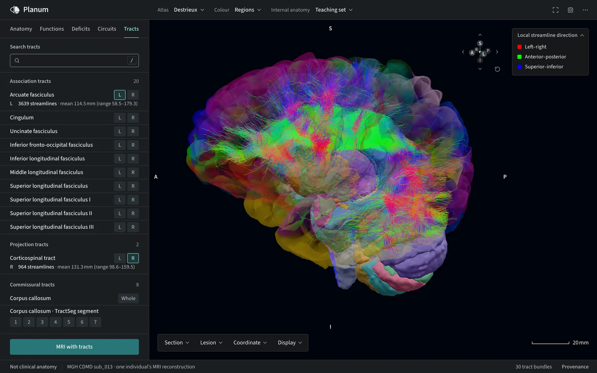

<p align="center">
  <a href="https://planumatlas.com/">
    <picture>
      <source media="(prefers-color-scheme: dark)" srcset=".github/assets/planum-dark.svg">
      
    </picture>
  </a>
</p>

<p align="center"><strong>A real human brain, explored in your browser.</strong><br>
Explore, cut, measure and question one person's MRI-reconstructed brain. Nothing to install.</p>

<p align="center">
  <a href="https://planumatlas.com/"><strong>Open Planum</strong></a> ·
  <a href="https://planumatlas.com/docs/">Documentation</a> ·
  <a href="https://planumatlas.com/docs/validation.html">Validation and limits</a>
</p>

<p align="center">
  <a href="https://github.com/JoshuaDuq/neuroatlas/actions/workflows/deploy.yml"></a>
  <a href="LICENSE"></a>
  
</p>

[](https://planumatlas.com/#anatomy=cdmd&lang=en&detail=learning&atlas=destrieux&cuts=destrieux&tab=diffusion)

Textbook figures show an idealised brain, and many 3D models are drawn by artists. Planum shows a **real one**: MGH CDMD subject `sub_013`, reconstructed from its own T1 scan with FreeSurfer 8.2, with tracts from the same person's diffusion scan. Every region, cut face and number in the viewer traces back to that data or to a cited atlas, and the app shows you which.

It is built for people who need to understand where things are in the brain:

- **Students** learning neuroanatomy on real folds instead of a diagram.
- **Teachers** who want to show a structure, a section or a pathway with a link that opens the same view for every student.
- **Researchers** who need to check where an atlas area, a function map or a lesion sits, and export the numbers.

## What you can do

### Explore every region, from gyri to nuclei

Search or browse 148 Destrieux parcels, 360 HCP-MMP areas or 278 Julich-Brain cytoarchitectonic areas on the cortex, and 514 NextBrain labels beneath it, down through the brainstem and a 34-region cervical spinal cord. Select any region for its volume or surface area, centroid, source label, functional division and typical arterial supply. **Focus**, **Isolate** or **Hide** it to dissect the brain layer by layer.

### Cut it open and check it against the scan

[](https://planumatlas.com/#anatomy=cdmd&lang=en&detail=learning&atlas=destrieux&cuts=destrieux&region=learning:left:hippocampus&cut=coronal&pos=-20)

Slice sagittally, coronally, axially or at any oblique angle. Each structure is capped where the plane meets it, and the cap is coloured from the label volume, not painted on. Open **Linked MRI** to see the subject's own T1 in three planes around a shared crosshair, with window and level, a segmentation overlay, the label under the cursor and PNG export.

[](https://planumatlas.com/#anatomy=cdmd&lang=en&detail=learning&atlas=destrieux&cuts=destrieux&region=learning:left:hippocampus&cut=coronal&pos=-20)

### Follow the white matter

Load any of 30 tract bundles reconstructed from this subject's diffusion MRI: association, projection and seven callosal segments, each with its streamline count and length range. Colour shows local direction, a slider filters short streamlines, and **Export lengths CSV** gives you the numbers. **MRI with tracts** opens the subject's T1 and FA images on linked slices.

### See where a function is studied

[](https://planumatlas.com/#anatomy=cdmd&lang=en&detail=learning&atlas=hcp-mmp&cuts=hcp-mmp&tab=functions&function=language)

Paint the cortex and deep structures with 70 curated functions, from working memory to face processing, based on Neurosynth meta-analyses. Each map lists its areas from strongest to weakest, with study counts, and says plainly what it is: where studies of healthy groups report activation, not what this brain does.

### Map what damage is associated with

[](https://planumatlas.com/#anatomy=cdmd&lang=en&detail=learning&atlas=destrieux&cuts=destrieux&tab=deficits&deficit=neglect&view=right)

Seventy profiles of acquired adult deficits, from aphasia and amnesia to neglect and ataxia, colour the regions their cited findings name. Every finding carries its population, evidence and limits, so you can see why a region is there and how strong the case is.

### Take a guided tour

[](https://planumatlas.com/#anatomy=cdmd&lang=en&detail=learning&atlas=destrieux&cuts=destrieux&tab=circuits&circuit=memory&step=1)

Nine tours step through vision, memory, basal ganglia motor loops, hearing, touch, language, spatial attention, cerebellar output and praxis. Each landmark opens the right atlas, reveals the hidden anatomy around it and frames it, with notes on what the tour simplifies.

### Ask what a lesion would reach

[](https://planumatlas.com/)

Drop a sphere of 3 to 30 mm anywhere on the brain or a cut face. The report lists the functions whose territories it overlaps, the deficits whose cited regions it reaches, the tissue it contains region by region, and the tract streamlines that pass through it. It measures overlap only; it predicts nothing about a patient.

### And more

- **Compare atlases.** See how a Destrieux region and the HCP-MMP areas share its surface, in mm², and download every pair as CSV.
- **Colour by network.** Yeo 7 or CAB-NP functional networks.
- **Go deeper on a region.** Region details add receptor fingerprints (36, from EBRAINS) and typical arterial supply, from territories of 15 branches per hemisphere mapped in 1,298 stroke patients.
- **Know how sure a boundary is.** NextBrain regions show where the segmentation nearly chose a neighbouring label.
- **Share exactly what you see.** The address bar holds the selection, camera, section and display, so a link reopens the same view. **Save image** exports the stage with its orientation letters, scale bar and colour key.
- **Use it anywhere.** English or French, full keyboard control, and a touch layout for phones and tablets.

## Built to be checked

Planum is a reference, so its numbers have to hold. [`brain_model/validate.py`](brain_model/validate.py) reads every published anatomy back against its sources: volumes decode back to the source scans exactly, solids are re-voxelised with no voxel centre misclassified, projected atlases are re-derived, segmentations must agree with the subject's own (Dice 0.8 or more, with documented exceptions), and the spinal cord must match its segmentation (Dice 0.967 measured). CI runs it, the Python tests and the web tests on every pull request and deployment. The viewer's **Provenance** panel lists the subject, reconstruction, atlases, files and sources behind what you see.

The anatomy is one individual, not a population average, and projected atlases, functional maps and tractography each have limits that the docs set out. **Planum is for research and education, not clinical decisions.** See [validation and limits](https://planumatlas.com/docs/validation.html).

## Run it yourself

The viewer needs Node.js and a WebGL 2 browser. The repository includes the published assets; no Python build is needed to explore them.

```bash
cd web
npm ci
npm run dev
```

Open the address printed by Vite (normally `http://127.0.0.1:5173/`). The repository is large because it includes model and diffusion data.

### Build and verify an anatomy

The Python pipeline requires [uv](https://docs.astral.sh/uv/) and Python 3.12 or 3.13. The committed sources are sufficient to rebuild the published anatomy:

```bash
uv sync --locked
uv run python -m brain_model.build --anatomy cdmd
uv run python -m brain_model.validate --anatomy cdmd
```

To run tests and build the documentation:

```bash
uv run pytest
npm test --prefix web
uv sync --locked --group docs
uv run sphinx-build -W -b html docs docs/_build/html
```

See [installation](https://planumatlas.com/docs/install.html) and [building an anatomy](https://planumatlas.com/docs/guides/building.html) for prerequisites, source preparation and regeneration.

### Embed it

`BrainAtlas` and `BrainSections` work in any Three.js application without the viewer's interface: load an anatomy, pick regions, and cut it with capped sections. The [embedding guide](https://planumatlas.com/docs/guides/embedding.html) shows how.

## Data and licences

The code is licensed under the [GNU AGPL 3.0 or later](LICENSE), with the scope set out in [NOTICE](NOTICE): anyone who runs a modified version for others, including as a website, must offer them its source. Data have separate terms. In particular, HCP-MMP data have HCP use terms, CAB-NP is non-commercial, Julich-Brain is CC BY-NC-SA, the Nettekoven cerebellar atlas and SUIT template are CC BY-NC 3.0, the arterial territory atlas is CC BY-SA 4.0, Neurosynth-derived databases are ODbL, and the Schaefer parcellation and PAM50 cord atlas are MIT. TractSeg-derived bundles require attribution. See [references and licensing](https://planumatlas.com/docs/reference/references.html) for sources, citations and complete terms.
