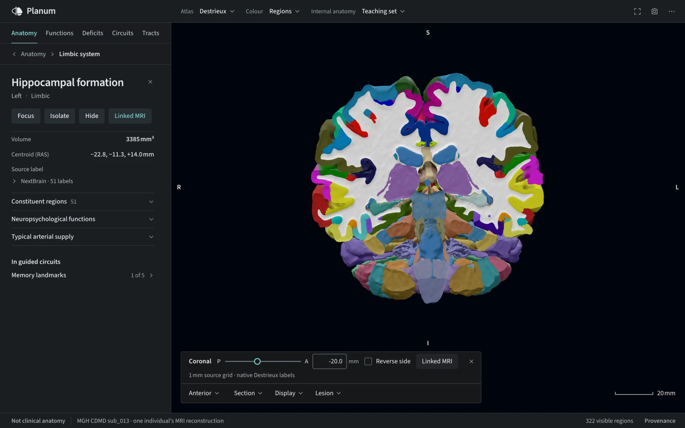
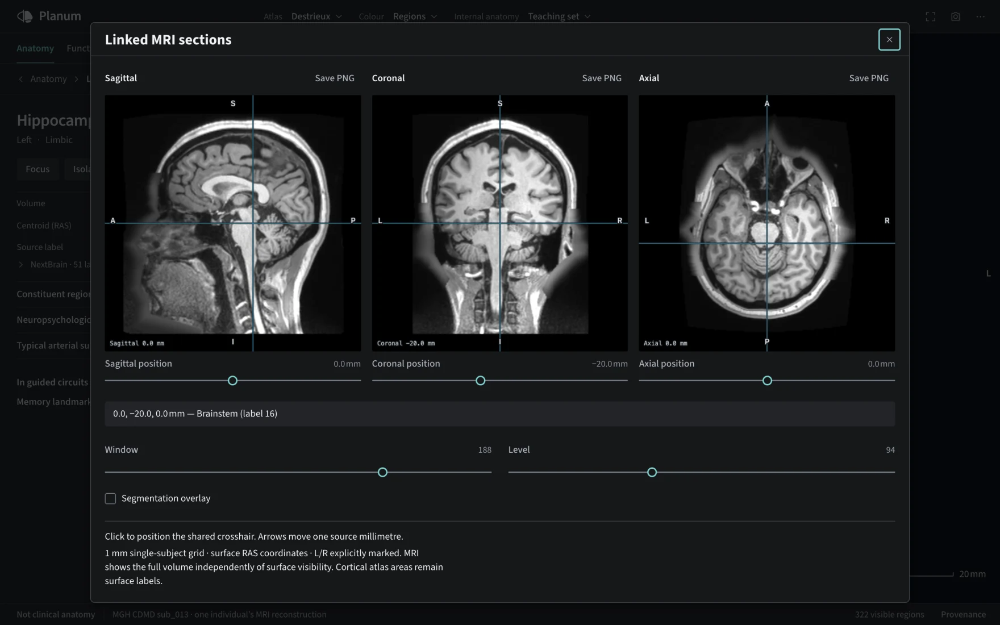
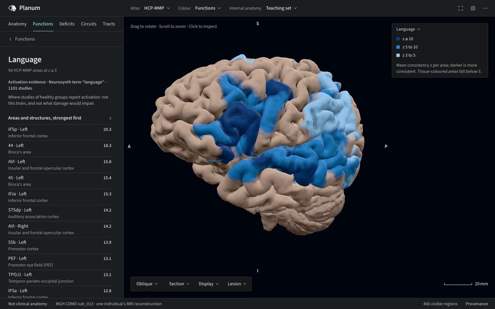
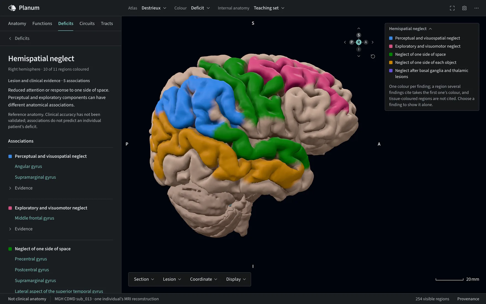
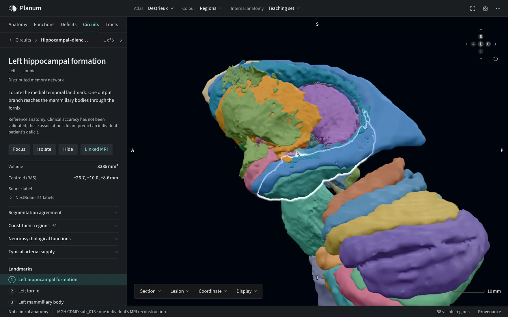
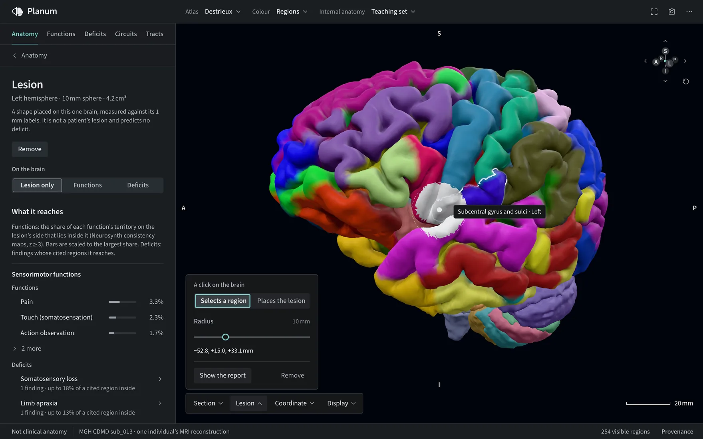

# Planum documentation

```{rst-class} hero-lede
A real human brain, explored in your browser: cut it, measure it, follow its tracts, and see what each region is known for.
```

Planum shows MGH CDMD subject `sub_013`, reconstructed from its own T1 scan with FreeSurfer 8.2, with tracts from the same person's diffusion scan. Every region, cut face and number traces back to that data or to a cited atlas. A Python pipeline builds the assets; a browser viewer displays them, with nothing to install. Planum is for research and education; it is **not clinical anatomy**.

```{figure} ../.github/assets/readme/tracts.webp
:alt: Diffusion tract bundles inside a translucent Destrieux-coloured brain, with the Tracts panel listing streamline counts and lengths
:class: hero-figure
:target: https://planumatlas.com/#anatomy=cdmd&lang=en&detail=learning&atlas=destrieux&cuts=destrieux&tab=diffusion

Tracts from the subject's own diffusion scan inside its Destrieux-coloured cortex. Select the image to open this view.
```

## What you can do

::::{container} feature-grid

:::{container} feature
[](guides/viewer.md#stage)

**[Cut it open](guides/viewer.md#stage)**

Sagittal, coronal, axial or oblique sections, each solid capped and coloured from the label volume.
:::

:::{container} feature
[](guides/viewer.md#linked-mri)

**[Check it against the scan](guides/viewer.md#linked-mri)**

The subject's own T1 in three planes around a shared crosshair, with the label under the cursor.
:::

:::{container} feature
[](guides/functions-and-deficits.md#functions)

**[See where a function is studied](guides/functions-and-deficits.md#functions)**

70 curated functions from Neurosynth meta-analyses, each area ranked by its consistency.
:::

:::{container} feature
[](guides/functions-and-deficits.md#deficits)

**[Map what damage is associated with](guides/functions-and-deficits.md#deficits)**

70 acquired deficits, each finding with its population, evidence and limits.
:::

:::{container} feature
[](guides/circuits.md)

**[Take a guided tour](guides/circuits.md)**

Nine tours, from vision to praxis, that reveal and frame each landmark.
:::

:::{container} feature
[](guides/viewer.md#lesion-report)

**[Ask what a lesion would reach](guides/viewer.md#lesion-report)**

A 3–30 mm sphere's overlap with functions, deficits, tissue and tracts. It predicts no deficit.
:::

::::

Search or browse 148 Destrieux parcels, 360 HCP-MMP areas, 278 Julich-Brain areas, 400 Schaefer parcels and 514 NextBrain labels, down to 32 functional cerebellar regions and a 34-region cervical cord. Compare any two cortical atlases by shared surface, colour the cortex by functional network, and share any view as a link: the address bar holds the selection, camera, section, display and a placed lesion. The viewer works in English and French, by keyboard, and on phones.

## Find your way

[Use the viewer](guides/viewer.md)
: Search and select regions, make sections, and inspect linked MRI.

[Install and build](install.md)
: Run the viewer locally, build an anatomy, or build this documentation.

[Explore the data](concepts/atlases.md)
: Understand the atlases, segmentations, functional layers, and their sources.

[Validation and limits](validation.md)
: Learn what is checked against the source and how to interpret the result.

[Developer reference](api/index.md)
: Browse the Python pipeline API or [embed the viewer components](guides/embedding.md) in a Three.js application.

The anatomy represents one individual; its folds and asymmetries are not normative. Atlas projections and segmentations are estimates. See [Anatomies](concepts/anatomies.md) and [References and licensing](reference/references.md) for provenance and data terms.

```{toctree}
:hidden:
:caption: Get started

install
```

```{toctree}
:hidden:
:caption: Guides

guides/viewer
guides/functions-and-deficits
guides/circuits
guides/tracts
guides/embedding
guides/building
```

```{toctree}
:hidden:
:caption: Concepts

concepts/architecture
concepts/atlases
concepts/anatomies
```

```{toctree}
:hidden:
:caption: Validation

validation
```

```{toctree}
:hidden:
:caption: API reference

api/index
```

```{toctree}
:hidden:
:caption: Reference

reference/references
```

```{toctree}
:hidden:
:caption: Project

Open the viewer <https://planumatlas.com/>
Source on GitHub <https://github.com/JoshuaDuq/neuroatlas>
```
